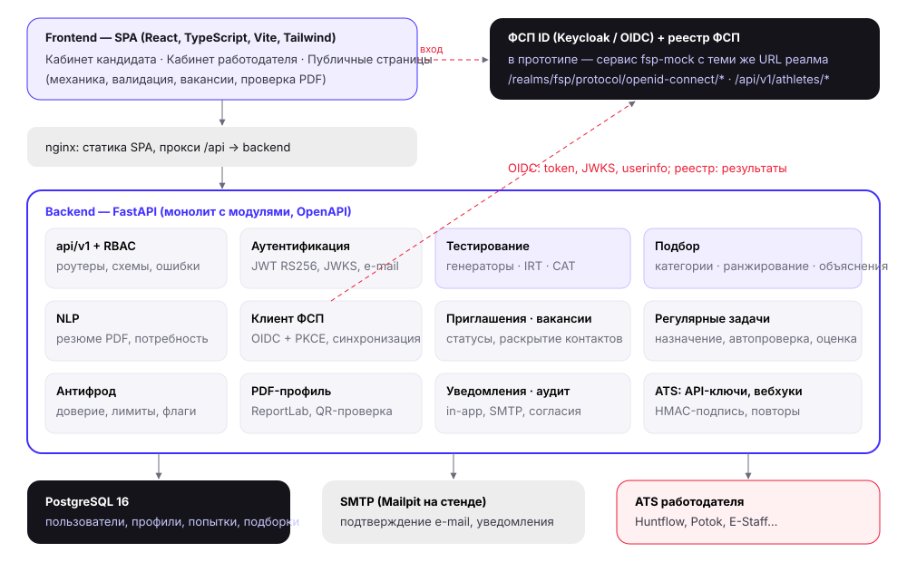

# 1. Архитектура решения

## 1.1. Функциональная архитектура

Платформа соединяет напрямую двух участников — кандидата и работодателя. Сторонние вакансии не агрегируются.

| Роль | Функции |
|---|---|
| **Кандидат** | регистрация по e-mail с подтверждением или вход через ФСП ID; профиль вручную или из PDF-резюме (автораспознавание ФИО, контактов, стека, стажа, грейда, ролей, софт-скиллов); **опрос** по направлению (отрасли ИТ) и специализации; выбор предполагаемого грейда; **адаптивный тест** → категория «специализация × грейд»; история опросов, попыток и смен грейда; пересдача уровнем ниже/выше с ограничением частоты; **входящие приглашения** с вилкой и способом связи (принять / отклонить с причиной / пожаловаться); вакансии и отклики; регулярные задачи от работодателей; приватность, журнал согласий 152-ФЗ, выгрузка и удаление данных; связь с ФСП ID и синхронизация достижений; стандартизированный PDF-профиль с QR-проверкой; **переписка** с работодателем после принятия приглашения и **отзыв доступа к контактам**; регистрация с 15 лет (15–17 — с согласием законного представителя); **рост и зарплаты**: зарплатный радар категории (обезличенно) и навыки, которые просят на следующем грейде |
| **Работодатель** | профиль компании и индекс доверия; **потребность** («кого ищем») формой или текстом с NLP-разбором; **подборка**: рекомендованные категории + ранжированные кандидаты с объяснением; уточнение подборки без её потери, избранное и скрытые; карта категорий и поиск по банку кандидатов (специализация, грейд, стек, подтверждённость, ФСП, формат, город, ожидания); **приглашение** конкретному кандидату или группе (вилка обязательна) и отслеживание статусов и этапов найма; аналитика (конверсия, причины отказов); вакансии, отклики, рекомендованные кандидаты под вакансию; план теста под потребность/вакансию; регулярные задачи и оценка решений; API-ключи и вебхуки для ATS; **переписка** с кандидатом после принятия приглашения; кандидаты с неподтверждённым грейдом видны со статусом и ниже подтверждённых; **сравнение 2–3 кандидатов** «почему A выше B» |
| **Публичная часть** | лендинг, описание механики подбора, интерактивная демонстрация механики тестирования (генерация вариантов, симулятор CAT), отчёт валидации, проверка подлинности PDF-профиля, список вакансий |
| **Администратор** | сводка, жалобы, подозрительные попытки, онлайн-калибровка банка (API) |

### Сквозной сценарий (обратная механика)

```
Кандидат                                   Платформа                                   Работодатель
────────                                   ─────────                                   ────────────
регистрация → подтверждение e-mail
опрос (направление, специализация, стек)
выбор грейда → адаптивный тест ─────────▶ θ̂, SE, профиль компетенций
                                           категория «Backend · Middle», блокировка
                                           смены грейда на 90 дней
                                           ◀──────────────────────────────────────── потребность (текст → NLP → форма)
                                           подборка: целевые и смежные категории,
                                           ранжирование, объяснение, P(принятия) ─────▶ уточнение, избранное
приглашение: описание, вилка, компания, ◀─────────────────────────────────────────── «Пригласить» (вилка обязательна)
способ связи (статус «просмотрено»)
принять ───────────────────────────────▶ раскрытие контактов, вебхук в ATS ─────────▶ контакты, этапы найма
   или отклонить с причиной ───────────▶ аналитика причин отказа ──────────────────▶ «60% отказов — зарплата»
```

## 1.2. Компонентная архитектура



| Компонент | Технологии | Ответственность |
|---|---|---|
| **frontend** | React 18, TypeScript, Vite, Tailwind CSS, TanStack Query, Recharts | SPA для обеих ролей и публичных страниц; адаптивная вёрстка; в Docker — nginx со статикой и прокси `/api` |
| **backend** | Python 3.13, FastAPI, SQLAlchemy 2, Pydantic 2 | REST API (OpenAPI), RBAC, бизнес-логика; монолит с явным разделением слоёв и слабо связанными модулями |
| **PostgreSQL** | PostgreSQL 16 | реляционное хранилище, JSONB для гибких структур (профиль компетенций, объяснения) |
| **fsp-mock** | FastAPI, PyJWT | демо-стенд ФСП ID с URL и форматом токенов Keycloak + API реестра достижений; заменяется настоящими сервисами ФСП без изменения кода платформы |
| **Mailpit** | — | SMTP-ловушка с веб-интерфейсом для демонстрации подтверждения e-mail |

### Модули backend

```
app/
  api/v1/        HTTP-слой: auth, candidate, assessment, employer, public (+ATS, admin). Зависимости RBAC: require_role, current_candidate
  core/          конфигурация, БД, безопасность (Argon2id, JWT RS256, JWKS), ошибки, rate limiting
  models/        ORM-модели (users, candidate_profiles, test_attempts/items, hiring_needs, shortlist_entries, invitations, ...)
  schemas/       Pydantic-схемы запросов (валидация, описание полей для OpenAPI)
  catalog/       справочники: направления, специализации, грейды, компетенции, онтология ~130 навыков, дисциплины ФСП
  testing/       bank/ (226 шаблонов-генераторов), irt.py (3PL, EAP, person-fit), cat.py (адаптивный алгоритм), blueprint.py, service.py
  matching/      scoring.py (формула и объяснения), service.py (подборки, поиск, карточки), strength.py, text.py (TF-IDF)
  nlp/           resume_parser.py (PDF → поля), need_parser.py (текст потребности → запрос)
  fsp/           client.py (OIDC + PKCE, реестр), scoring.py (оценка достижений)
  services/      invitations, tasks, trust (антифрод), webhooks (ATS), pdf, common (почта, уведомления, аудит, согласия)
  seed/          синтетические данные
  validation/    Монте-Карло тестирования, оценка подбора, калибровка, графики
```

Модули общаются через функции сервисного слоя; HTTP-слой не содержит бизнес-логики. Механики тестирования и подбора
(`testing/cat.py`, `matching/scoring.py`) — чистые функции над dataclass-представлениями, поэтому одна и та же логика
используется в API, в генерации синтетических данных и в процедуре валидации.

## 1.3. Модель данных (основные сущности)

| Таблица | Назначение |
|---|---|
| `users` | учётные записи (роль, e-mail, Argon2id-хеш пароля, подтверждение e-mail, `fsp_sub` — связь с ФСП ID) |
| `candidate_profiles` | три слоя: **самоописание** (резюме, заявленный грейд и навыки, возрастная группа 18+ / 15–17), **верифицированный слой** (грейд, θ̂ ± SE, профиль компетенций, подтверждённые навыки, ФСП-оценка), **служебный** (сила профиля, перцентиль в категории); настройки приватности и видимости |
| `candidate_categories` | дополнительные категории кандидата (до двух): свой грейд, результат теста, блокировка и подтверждённые навыки в каждой |
| `survey_responses`, `grade_changes` | история опросов и изменений грейда |
| `test_attempts`, `test_items` | попытки и выданные экземпляры заданий: текст варианта, серверный ключ ответа, ответ, время, события фокуса/вставки, IRT-параметры |
| `item_stats` | экспозиция и калиброванные параметры семейств заданий, флаг дрейфа |
| `fsp_achievements` | результаты соревнований из реестра ФСП (подписанные записи) |
| `companies` | профиль работодателя, индекс доверия и его факторы |
| `hiring_needs`, `shortlist_entries` | потребности и сохранённые подборки (оценка, ранг, объяснение, пометки работодателя) |
| `invitations` | приглашения: описание, вилка (gross), способ связи, статус, этап найма, причина отказа, объяснение, отзыв доступа к контактам |
| `messages` | переписка кандидата и работодателя внутри принятого приглашения (без обмена контактами) |
| `vacancies`, `applications` | вакансии (в том числе синхронизированные из ATS по `external_id`) и самостоятельные отклики |
| `employer_tasks`, `task_assignments` | регулярные задачи и решения кандидатов |
| `consents`, `audit_log`, `notifications`, `refresh_tokens`, `oidc_states` | 152-ФЗ, аудит, уведомления, сессии, состояния OIDC |
| `reports`, `api_keys`, `webhooks`, `webhook_deliveries` | антифрод и интеграция с ATS |

## 1.4. Фирменный стиль ФСП

Интерфейс, письма, PDF-профиль кандидата, демо-страница ФСП ID и эта документация оформлены по брендбуку ФСП
(«Руководство по использованию фирменного стиля»):

| Элемент брендбука | Как применён |
|---|---|
| Цвета логотипа #402FFF, #EC1D35, #EDEDED; градации серого #1B1C21 · #2D2E37 · #3A3C46 · #9B9C9E · #D9D9D9 | токены темы (`tailwind.config.js`): основной цвет действий — #402FFF, акцент и курсор знака — #EC1D35, тёмные поверхности — графит #1B1C21 / #2D2E37 / #3A3C46 |
| Digital-акцент #0A006B (сайт, соцсети, баннеры) | градиент тёмных полос: главная, страница входа, обложка документации |
| Основной шрифт JetBrains Mono, акцентный TDAText | заголовки, подписи, цифры — JetBrains Mono; словесный знак «ДРАФТ_» и крупные числа — TDAText; длинный текст — Inter (основной шрифт флагманских проектов ФСП). Все три — локально, без внешних CDN |
| Логотип ФСП (полноцвет, для тёмного и светлого фона) | официальные файлы брендбука без изменений: сокращённый вариант — в шапке рядом с «Драфтом» (как у флагманских проектов: собственный знак + логотип Федерации), полный — в подвале, на странице входа и обложке документации; знак-звезда — на кнопке «Войти через ФСП ID» и в иконке сайта |
| Гибридные паттерны (символы кода) | полоса паттерна в цветах #402FFF / #EC1D35 / #EDEDED: низ первого экрана, подвал, меню кабинета, страница входа, обложка документации |
| Цветовой код дисциплин ФСП (фиолетовый — продуктовое, синий — алгоритмическое, бирюзовый — БАС, жёлтый — робототехника, зелёный — ИБ) | значки и метки достижений ФСП в профиле кандидата |
| Голос бренда: «_» перед пунктами, моноширинные заголовки прописными | подзаголовки разделов, панель входа, заголовки глав документации |

Логотип Министерства спорта из комплекта не используется: прототип не является официальным материалом министерства.

## 1.5. Нефункциональные свойства

* **Производительность.** Ранжирование подборки по ~700 кандидатам — десятки миллисекунд; выдача следующего задания CAT — < 50 мс.
  Две копии uvicorn-воркеров в контейнере; ресурсы стенда < 1 ГБ RAM (замер под нагрузкой — ниже).
* **Кэш дорогих чтений.** Поиск по банку кандидатов, карта категорий и карточки кандидатов кэшируются в памяти воркера;
  ключ включает версию данных (время последнего изменения профилей), поэтому изменения видны сразу. Воркеров uvicorn —
  по числу ядер (до 4).
* **Масштабирование.** Backend без состояния (JWT), горизонтально масштабируется за балансировщиком; инициализация БД защищена
  advisory-lock PostgreSQL. Тяжёлые фоновые операции (вебхуки) — в фоне ответа; для продакшена выносятся в очередь (см. п. 10).
* **Платформенность.** Docker-образы на Debian slim/alpine, запуск на любой ОС с Docker; адаптивная вёрстка для смартфонов и планшетов.
* **Качество кода.** Сложные решения прокомментированы в коде (IRT, CAT, генераторы, формула подбора); 278 автотестов бэкенда, 14 тестов компонентов и 7 браузерных сценариев фронтенда.
* **Без LLM и без GPU.** Большие языковые модели **не используются** ни в обязательном пути, ни опционально: задания
  порождаются детерминированными генераторами с вычисляемым ответом (ключи проверены исполнением кода, п. 2.1), разбор
  резюме и вакансий, категоризация и подбор — словари, правила, TF-IDF и интерпретируемые формулы на CPU. Поэтому
  персональные данные не передаются внешним сервисам (в том числе трансгранично), нет затрат на API, а результат
  воспроизводим. Организаторы допускают облачные LLM, в том числе зарубежные, с предпочтением открытых моделей разумного
  размера; если позже понадобится LLM (например, объяснение подборки текстом), предполагается открытая модель, развёрнутая
  у оператора платформы, и передача ей только обезличенного профиля (категория, навыки, без ФИО и контактов) — так не
  возникает трансграничной передачи персональных данных по 152-ФЗ.
* **Ресурсы стенда проверки.** Весь стек (PostgreSQL, backend с 4 воркерами, frontend, fsp-mock, Mailpit) занимает
  ≈ 1 ГБ RAM под нагрузкой. Замер в Docker на 5 ядрах и 4 ГБ, сценарии подборки, поиска, карточек и кабинетов без пауз
  между запросами: **20 одновременных пользователей — 498 запросов/с, p95 ≤ 0,13 с; 50 — 432 запроса/с, p95 ≤ 0,30 с;
  0 ошибок.** До кэша и масштабирования воркеров было 150 запросов/с и p95 до 0,73 с. С большим запасом укладывается
  в ориентир жюри (≈ 8 CPU, 32–64 ГБ, без GPU).