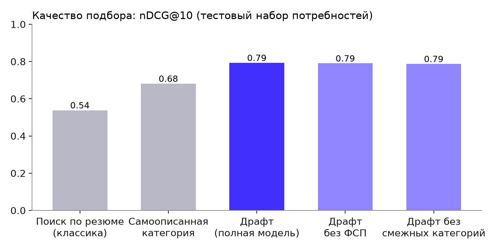
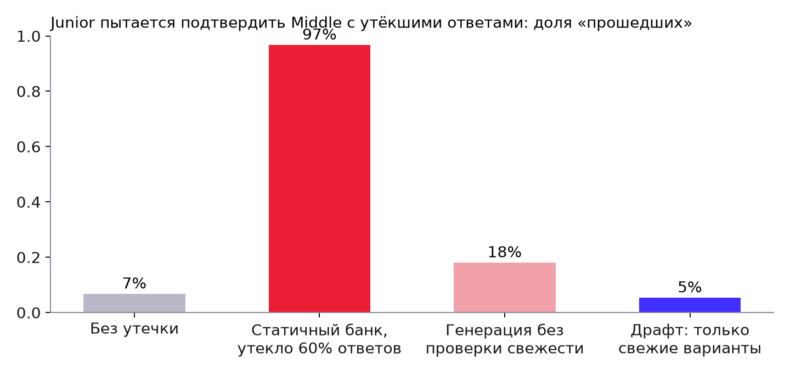

# 4. Собственная процедура валидации и её результаты

Отчёт сформирован 2026-10-08 10:07 командой `python -m app.validation.run_all` (≈ 10 секунд), исходные данные —
`backend/validation_results/report.json`, интерактивная версия — страница **/validation** в приложении.

## 4.1. Идея: синтетическая популяция со скрытой «истиной»

Эталонных датасетов и разметки в задаче нет. Поэтому мы строим популяцию, где **истина известна, но скрыта от системы**:

* у каждого синтетического кандидата есть истинная способность θ, истинный грейд и **реальный** набор навыков;
* наблюдаемые данные зашумлены, как в жизни: **25% завышают** грейд на ступень, 8% занижают, **20% «набивают» резюме**
  навыками, которыми не владеют, 10% заявленных навыков теряются;
* ответы на задания моделируются 3PL-моделью с **«истинными» параметрами, отличными от калибровочных** (шум ±0.3 по b,
  ±15% по a) — система работает с неточными параметрами, как в реальности до калибровки;
* у 36% кандидатов есть история ФСП из синтетического реестра; сила спортсмена коррелирует с его θ, а стек его
  результатов — с реальными навыками;
* тест кандидата в базе пройден **тем же CAT-движком**, что и у живых пользователей.

Система видит только наблюдаемое; качество измеряется сравнением с истиной. Это отвечает на главный вопрос ТЗ:
помогает ли верифицированный профиль находить подходящих людей лучше, чем самоописанное резюме.

## 4.2. Механика тестирования (Монте-Карло, 1200 виртуальных кандидатов, каждый проходит тест дважды)

Конфигурация: **классификационная остановка** — тест завершается, как только по каждому порогу грейда апостериорная
вероятность «выше» или «ниже» достигла 85%; от 8 до 22 заданий
(медиана — 14, 10-й перцентиль — 8, 90-й — 22;
дольше 14 заданий тест длится у 47% — это пограничные случаи).

### Точность категоризации (соответствие эталону)

| Метрика | Значение |
|---|---|
| Грейд по тесту совпадает с истинным | **81%** (заявленный самим кандидатом — 74%) |
| Ошибка не больше одной ступени | 100% |
| Точное совпадение, если истинная θ дальше 0.25 от порога грейда | 90% |
| κ Коэна / взвешенная κ | 0.74 / 0.90 |
| Корреляция θ̂ с истинной θ, RMSE, смещение | 0.940, 0.39, +0.003 |
| Решение «грейд подтверждён»: чувствительность / специфичность | 92% / 77% |
| Среднее число заданий / средняя SE | 14.8 / 0.41 |
| Завысили грейд в анкете (19% популяции): тест **не подтвердил** завышенный грейд | **85%** (точно вернул к истинному — 77%) |
| Заявили грейд честно: тест подтвердил заявленный | 82% |

Матрица ошибок (строки — истинный грейд, столбцы — грейд по тесту):

| | Стажёр | Junior | Middle | Senior |
|---|---|---|---|---|
| **Стажёр** | 129 | 32 | 0 | 0 |
| **Junior** | 32 | 272 | 54 | 0 |
| **Middle** | 0 | 34 | 313 | 46 |
| **Senior** | 0 | 0 | 30 | 258 |

Все ошибки — на соседний грейд и сосредоточены у порогов, где ±1 стандартная ошибка измерения пересекает границу
полосы. Точность в зависимости от расстояния истинной θ до ближайшего порога:

| Расстояние до порога (логиты) | Доля популяции | Точность грейда |
|---|---|---|
| 0–0.1 | 15% | 56% |
| 0.1–0.25 | 23% | 72% |
| 0.25–0.5 | 38% | 86% |
| > 0.5 | 24% | 98% |

У кандидата, чья способность лежит ровно на границе Junior/Middle, «правильного» грейда по сути нет — любой тест
разумной длины здесь ошибается почти в половине случаев. Политика «грейд не понижается принудительно» + пересдача
через 14 дней снимает остаточный риск для кандидата.

### Правило остановки: по точности оценки или по надёжности решения

Тест решает задачу классификации, поэтому мы сравнили прежнее правило (остановка при SE ≤ 0.35, 10–16 заданий,
задания по информации в θ̂) с классификационным (остановка, когда решение по каждому порогу надёжно; у границы
грейда задания подбираются по информации в точке порога; пограничным — до 22 заданий). Одна и та же популяция
из 1000 кандидатов, два независимых прохождения:

| Правило | Точный грейд | Вдали от порогов | Решение «подтверждён» | Повтор: тот же грейд | Заданий в среднем (макс.) |
|---|---|---|---|---|---|
| По точности (SE ≤ 0.35), прежнее | 81% | 88% | 89% | 73% | 15.4 (16) |
| **По надёжности решения (Драфт)** | 83% | 90% | 91% | 75% | 14.6 (22) |

Классификационная остановка точнее и при этом **короче в среднем**: очевидные случаи завершаются за 8–12 заданий,
а сэкономленное время уходит на спорные.


### Категоризация по стеку: разбор резюме на размеченном вручную наборе

Специализацию и навыки из резюме система предлагает кандидату при заполнении профиля (грейд затем подтверждает тест).
Чтобы проверить разбор не на собственных синтетических текстах, мы написали два набора резюме в разных стилях
(hh.ru, LinkedIn, свободный текст; русский и английский; сленг «реакт», «k8s», «докер»; разные форматы контактов и дат)
и разметили ФИО, контакты, город, специализацию, стаж и навыки онтологии: **основной** (24 резюме,
234 навыков) — по нему дорабатывался парсер, и **отложенный** (16 резюме,
131 навыков) — написан после доработки; первый замер на нём сделан до любых правок.

| Поле | Основной набор | Отложенный: первый замер | Отложенный: после правок |
|---|---|---|---|
| ФИО | 100% | 94% | 100% |
| E-mail | 100% | 100% | 100% |
| Телефон | 100% | 100% | 100% |
| Telegram | 100% | 100% | 100% |
| GitHub | 100% | 100% | 100% |
| Город | 100% | 100% | 100% |
| Специализация | 96% | 94% | 94% |
| Стаж (±0.5 года) | 100% | 81% | 100% |
| Навыки: precision / recall / F1 | 0.98 / 1.00 / **0.99** | 0.97 / 0.91 / **0.94** | 0.98 / 0.97 / **0.97** |

Оставшиеся ошибки — содержательные неоднозначности: fullstack PHP + Vue относится к frontend, C++-разработчик сетевого
шлюза — к информационной безопасности, MVVM засчитывается как «чистая архитектура». Кандидат подтверждает
распознанное перед сохранением, а категорию определяет тест — ошибка разбора резюме не меняет грейд.

### Согласованность (test–retest на разных формах)

| Метрика | Значение |
|---|---|
| Корреляция θ̂ двух прохождений | **0.882** |
| Совпадение грейда / κ / взвешенная κ | 73% / 0.63 / 0.85 |
| Совпадение решения «подтверждён / нет» | 86% |
| Грейды различаются не больше чем на ступень | 100% |
| Доля общих семейств в двух формах одного кандидата | 36% (варианты при этом разные) |

### Дискриминативность

| Метрика | Значение |
|---|---|
| AUC разделения соседних грейдов по θ̂ | intern→junior: 0.917, junior→middle: 0.943, middle→senior: 0.941 |
| Средняя θ̂ по истинным грейдам | Стажёр -1.42, Junior -0.46, Middle +0.50, Senior +1.58 |
| Медиана точечно-бисериальной корреляции задания с θ̂ (по 197 семействам) | 0.530; доля семейств с r > 0.2 — 98% |

### Устойчивость к утечке заданий

| Эксперимент | Результат |
|---|---|
| Уникальность вариантов (150 генераций на семейство) | медиана доли уникальных — 91%; вероятность совпадения двух вариантов — 0.87% |
| Атака: Junior (θ = −0.5) сдаёт Middle **без утечки** | проходит 7%, θ̂ = -0.47 |
| …**статичный банк**, утекло 60% ответов | проходит **97%**, θ̂ завышена на **+1.18** |
| …параметрический банк **без проверки свежести**: известны варианты 40 предыдущих кандидатов | проходит 18%, θ̂ завышена на +0.14; из утечки отвечено 9% заданий |
| …**«Драфт»**: то же, но сервер не выдаёт уже показанный вариант | проходит **5%** (как без утечки), θ̂ сдвинута на **-0.03**; из утечки отвечено **0%** заданий |
| Максимальная экспозиция семейства (узкая популяция, Backend) | randomesque: 49%; без контроля (максимум информации): 100% |
| Пересечение форм двух кандидатов | 18% против 33% без контроля экспозиции |
| Смешанная популяция всех специализаций | макс. экспозиция 29%, задействовано 225 семейств |

### Контрольная форма при сигналах нечестности

Если попытка прошла порог, но индекс согласованности ответов lz < -2.5 или сработали два поведенческих сигнала
(уходы со вкладки, вставки, сверхбыстрые верные ответы на сложные задания), грейд не присваивается до короткой контрольной
формы: 6–10 свежих заданий у порога, таймер строже на 30%.

| Измерение (симуляция) | Результат |
|---|---|
| Честные кандидаты (800), отправлены на контрольную форму по lz | **0.6%** |
| «Помощь извне» на половине заданий (θ = −0.8, 300 попыток): проходят Middle | 86% |
| …из них распознаны по lz | 5% |

Вывод: статистический детектор почти не мешает честным, но живую подсказку в коротком адаптивном тесте ловит плохо —
это задача прокторинга, а не модели. От **утечки** (заученных чужих вариантов) защищает гарантия свежих вариантов выше;
поведенческие сигналы детектора оцениваются только на реальных попытках.

### Адаптивный тест против фиксированной формы той же средней длины (14 заданий)

| | Точность грейда | Средняя SE |
|---|---|---|
| CAT «Драфта» | **81%** | 0.42 |
| Фиксированная форма | 71% | 0.52 |

### Онлайн-калибровка и детекция утечки «способа решения»

| Метрика | Значение |
|---|---|
| Откалибровано семейств (≥ 30 ответов) | 181 |
| RMSE трудности b: априорная → после калибровки | 0.299 → **0.192** |
| Имитация: 8 семейств стали легче на 1.2 логита | найдено 7 из 8, ложных срабатываний 6 из 181 |

## 4.3. Механика подбора: тестовый набор пар «потребность — кандидат»

**Набор:** 217 потребностей (5 независимых наборов по 8 специализациям × 4 грейдам; стек
обязательных и желательных навыков — из реальных стеков треков, вилка — около рыночной медианы, формат — случайный) ×
620 опубликованных кандидатов, которые рассматривают предложения.

**Эталонная релевантность (0–3)** по скрытой истине:

* 0 — другая специализация, истинный грейд дальше ступени, нет ни одного обязательного навыка;
* 1 — соседний грейд ниже, слабое покрытие обязательных навыков (< 1/3);
* 2 — истинный грейд совпадает и навыки покрыты; или кандидат **сильнее запроса на ступень и укладывается в бюджет**;
* 3 — истинный грейд совпадает, реально владеет ≥ 2/3 обязательных навыков и находится в верхней половине грейда;
* −1 — ожидания выше вилки более чем на 10%; −1 — несовместимый формат работы.

Метрики: Precision@10 (доля релевантных ≥ 2 в топ-10), nDCG@10 (gain = 2^rel − 1), MRR, Recall@30, «шум» — доля
полностью нерелевантных в показанных топ-10.

| Ранжирование | P@5 | P@10 | nDCG@10 | MRR | Recall@30 | Шум@10 |
|---|---|---|---|---|---|---|
| Поиск по ключевым словам резюме (классическая площадка) | 0.586 | 0.520 | 0.538 | 0.780 | 0.689 | 0.159 |
| Самоописанная категория (наша формула без верифицированного слоя) | 0.732 | 0.619 | 0.681 | 0.911 | 0.864 | 0.072 |
| **Драфт — полная модель** | 0.848 | 0.718 | 0.793 | 0.979 | 0.908 | 0.057 |
| Драфт с экспертными весами (до подстройки) | 0.828 | 0.707 | 0.772 | 0.969 | 0.901 | 0.077 |
| Драфт без учёта ФСП | 0.844 | 0.714 | 0.790 | 0.977 | 0.907 | 0.057 |
| Драфт без смежных категорий | 0.844 | 0.715 | 0.787 | 0.979 | 0.775 | 0.045 |

* Разброс nDCG@10 между наборами потребностей: «Драфт» ± 0.014,
  классика ± 0.013 — выводы устойчивы.
* «Драфт» лучше классического поиска по резюме в **99%** запросов.
* Разница «полная модель − самоописанная категория» — вклад **верифицированного профиля** (грейд из теста, подтверждённые
  навыки, положение внутри грейда).
* Учёт ФСП не снижает релевантность и поднимает долю участников соревнований ФСП в топ-10 до **44%**
  при доле в базе 35% — требование ТЗ «выше те, у кого есть опыт ФСП» выполняется без потери качества.
* Смежные категории повышают Recall@30 — работодатель не теряет подходящих людей, когда целевая категория мала.
* **Веса формулы подобраны на отдельных наборах потребностей** (зёрна 201, 202, 203, `python -m app.validation.tune_matching`),
  а метрики выше посчитаны на других, независимых наборах. Подбор шёл внутри продуктовых рамок (навыки ≥ 20%, ФСП ≥ 10%,
  текст резюме ≤ 12%): без рамок поиск «подгонял» формулу под синтетику — увеличивал вес текста резюме и обнулял
  подтверждённые навыки и ФСП, что противоречит ТЗ. Итог против экспертных весов: nDCG@10 0.772 → **0.793**,
  P@5 0.828 → **0.848**.

### Проверка на внешнем наборе пар — инструмент для жюри

Механику можно проверить на **любом своём размеченном наборе** «вакансия — кандидат»: страница **/validation** → блок
«Проверьте подбор на своём наборе пар» (загрузка JSON), API `POST /api/v1/validation/external-eval` или консоль
`python -m app.validation.external_eval data.json`. Вакансии передаются текстом (разбираются тем же NLP, что и в
кабинете работодателя) или полями; кандидаты — текстом резюме или полями, при наличии — с результатом теста платформы и
достижениями ФСП; разметка — 0–3 или 0/1. Кандидат без теста ранжируется по заявленной категории, без ФСП — без бонуса.
Два протокола: **по всей базе** (неразмеченные пары — нерелевантны, как в продукте) и **только размеченные пары**.
Формат и пример — `docs/examples/eval_pairs_example.json`.

Прогон на примере (вакансии — тексты, кандидаты — тексты резюме, у 445 из 620
есть результат теста, у 218 — достижения ФСП; вакансий — 47, размеченных пар — 5728,
доля релевантных пар 10%):

| Протокол | Ранжирование | P@10 | nDCG@10 | MRR | Recall@30 |
|---|---|---|---|---|---|
| по всей базе | **Драфт** | 0.619 | 0.785 | 0.949 | 0.904 |
| по всей базе | Поиск по резюме (классика) | 0.489 | 0.581 | 0.750 | 0.691 |
| по всей базе | Потолок при этой разметке | 0.838 | 1.000 | 1.000 | 1.000 |
| только пары | **Драфт** | 0.636 | 0.810 | 0.970 | 0.937 |
| только пары | Поиск по резюме (классика) | 0.543 | 0.648 | 0.824 | 0.701 |
| только пары | Потолок при этой разметке | 0.838 | 1.000 | 1.000 | 1.000 |

nDCG@10 выше классического поиска в **42 из 47** вакансий. На пяти независимых выборках вакансий и кандидатов того же размера: nDCG@10 0.77 ± 0.02 против 0.56 ± 0.02, P@10 0.66 против 0.52. «Потолок» — максимум P@10,
достижимый при числе релевантных кандидатов в разметке (у части вакансий их меньше 10).

Графики: `matching_ndcg_at_10.png`, `matching_p_at_10.png`, `testing_confusion.png`, `testing_leak_attack.png`, `testing_exposure.png`.





## 4.4. Как воспроизвести и как продолжить валидацию с ФСП

```bash
cd backend && .venv/bin/python -m app.validation.run_all          # полный прогон
cd backend && .venv/bin/python -m app.validation.run_all --fast   # быстрый прогон
```

Ограничения: параметры заданий — экспертные априорные, уточняемые онлайн-калибровкой; выводы о подборе получены на
синтетических данных. План валидации на реальных данных после хакатона:

1. **Калибровка банка** на 300–500 прохождениях участников ФСП (MML-оценка a и b, анализ DIF между языковыми треками).
2. **Конвергентная валидность**: корреляция θ с рейтингом ФСП и местами на соревнованиях.
3. **Экспертная разметка подбора**: 20 потребностей × 30 кандидатов, разметка 2–3 рекрутерами (согласованность — κ),
   расчёт тех же P@10/nDCG@10 встроенным инструментом `app.validation.external_eval` (формат — `docs/examples`).
4. **A/B-тест в продукте**: доля принятых приглашений и время до найма — с подборкой «Драфта» и без неё.
